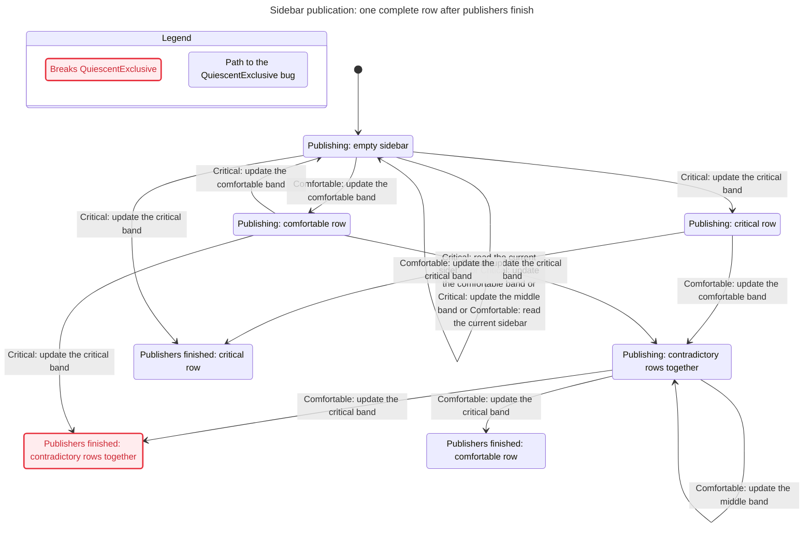
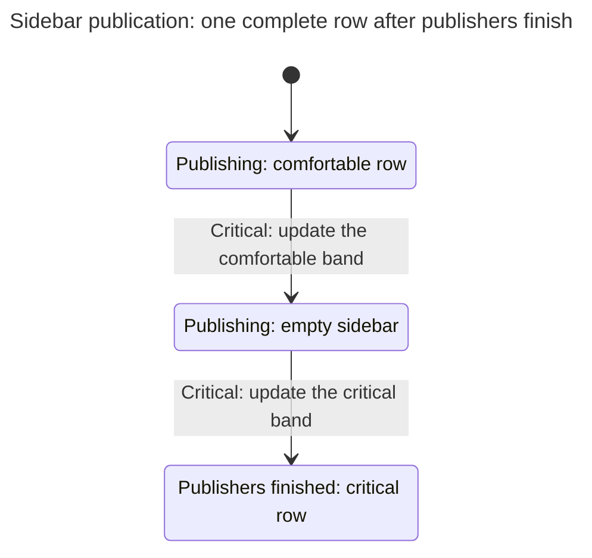
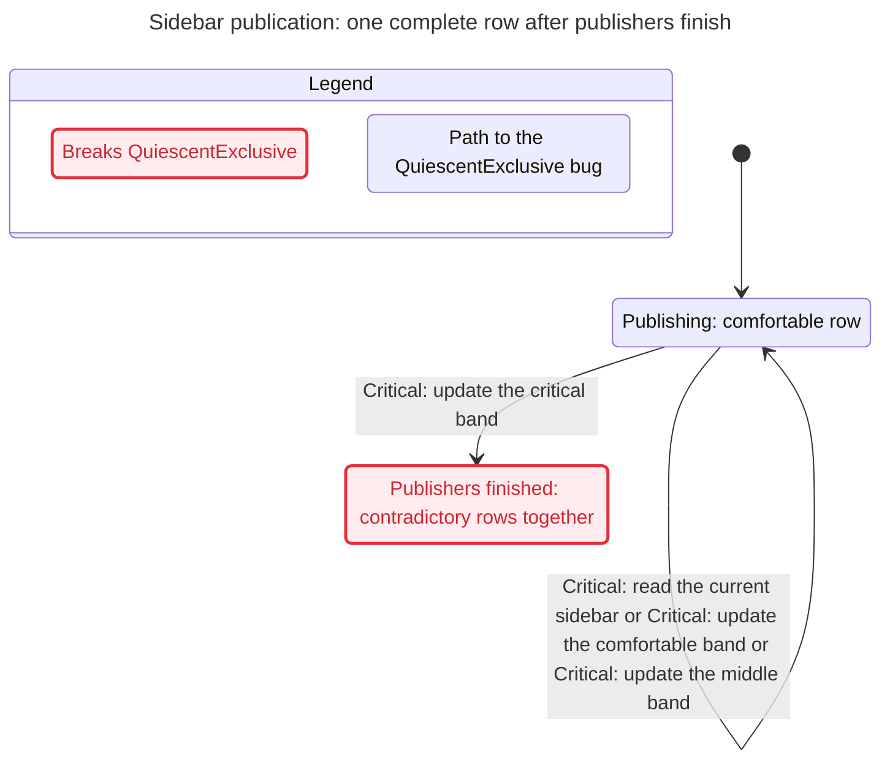

# Verification record — 2026-11-23

## Current-code finding

**Bug:** two completed limit publishers can leave `limit_high=5h 80%` and `limit_low=5h 20%` visible together. This violates the exclusive colour-band contract in `internal/core/limitband.go:4-6` and `internal/update/update.go:235-238`.

The code checked is commit `c0c74f5c5ad40c92d87fc62c38580940109d4ef2`. Product code was not fixed. The scratch mutation was restored byte-for-byte: `internal/update/update.go` has SHA-256 `a20b5b06b49eceefa8d8b4355e6fb481e81a9b049f6f3091eee57e4278bd1254` before and after the experiment.

The load-bearing operations are `ShouldWriteToken` (`internal/core/throttle.go:10-14`), the frozen `current` map passed through `writeMetadataTokenWith` (`internal/update/update.go:188-196`), and the three separate writes in `writeLimitBandTokensWith` (`internal/update/update.go:243-268`). `RunUpdateForPane` and `PublishCollectedLimitsWith` obtain independent pane snapshots; a snapshot is not a transaction covering all three writes.

TLA+ / TLC was selected because the question is whether a bad ordering of reads and per-token writes is possible, not whether a percentage formula is correct. TLC 1.7.4 is checksum-pinned; the runtime is Temurin 25.0.5+8.0.LTS. The replay uses Go 1.26.11 and the actual unexported writer via a temporary Go overlay.

## Executed scenarios

| Scenario | TLC exit | Actual Go replay exit | Interpretation |
| --- | ---: | ---: | --- |
| Current code, two publishers | 12 | 1 | `QuiescentExclusive` violated; both rows remain |
| Current code, one publisher changing high to low | 0 | 0 | Control passes |
| Real code with inactive clears removed, **unchanged** single-publisher model/check | 0 | 1 | Executable check detects the real source mutation even though the old model still passes |
| Same real-code mutation, matching `NoClears.cfg` model | 12 | 1 | Model and actual function both retain old high beside new low |
| Restored code, one publisher | 0 | 0 | Control passes again |
| Restored code, two publishers | 12 | 1 | Only the original concurrent finding remains |

The scripts return nonzero on the finding. No expected failure was relabeled as success. The intentionally failing Go replay files are hidden verification assets, not tests discovered by the normal repository suite.

Raw outputs are preserved under [evidence/](evidence/): `concurrent.*.out`, `single-restored.*.out`, `mutant-unchanged-model.*.out`, and `mutant-matched-model.*.out`. Temporary overlays were removed after each run.

## Statechart results and real-code replay

`/statechart` explored the bounded current-code graph past the violation: **41 states, 63 steps**. Its reader-facing chart has **7 states, 12 arrows**. The shortest counterexample has **8 steps**; it is recorded verbatim in [concurrent.report.md](evidence/concurrent.report.md), with generated Mermaid in [concurrent.mmd](evidence/concurrent.mmd).

### Current code



The final `replay/concurrent_test.go` exercises that order through the real Go function: its low-write callback snapshots the store for the other publisher immediately before committing the low row, then the second function call runs using that saved snapshot. Skips are executed by the real `ShouldWriteToken`, not by a second implementation of the publication algorithm. The assertion failed with:

```text
expected exactly one publisher's complete row after both finished: map[limit_high:5h 80% limit_low:5h 20%]
```

The control reaches **5 states** and passes; its generated chart is [single.mmd](evidence/single.mmd). The matched broken-clearing model also reaches **5 states** and has a shortest **4-step** violation, shown in [no-clears.mmd](evidence/no-clears.mmd). Its actual Go failure is:

```text
expected only the new critical row: map[limit_high:5h 94% limit_low:5h 20%]
```

### Single-publisher control



### Broken-clearing variant



The charts coarsen local program-counter states into reader-facing labels. The concurrent chart omits 38 intra-label steps except those needed to show the bug path; the single control omits 3; the broken-clearing chart omits 1. The raw reports retain every numbered counterexample step. No explicit `step()` filter discards model transitions.

## What this does and does not prove

The model covers one pane, three limit-band names, two publishers, one frozen snapshot and one token pass each, fixed nonempty high/low rows, `force=false`, `retainExistingOnEmpty=false`, and successful atomic individual token operations. It checks the visible result only when all publishers have completed. It does not mistake a transient intermediate empty or mixed state for the finding.

The replay demonstrates the actual Go decision logic with an in-memory metadata store. It is **not** an observation of a live Herdr sidebar. Herdr server implementation, failures/timeouts, other token families, providers, percentage formatting, infinite executions, and larger process counts are not proven. `force=true` is not a verified fix for non-atomic family publication.

## Rerun and maintain

From this worktree's root:

```sh
.agents/skills/verify-band-publication/scripts/check
```

The default must currently report the finding. Use the complete [SKILL.md](SKILL.md) workflow for drift review, `/statechart`, the passing control, real-code mutation and restoration. Use `/maintain-formal-verification-skill` after covered-code changes that skipped this check. Product remediation is a separate change.

## Repository checks after restoration

All commands below completed successfully with Go 1.26.11:

```sh
GOTOOLCHAIN=go1.26.11 go test ./internal/update ./internal/core -count=1
gofmt -l .
GOTOOLCHAIN=go1.26.11 go vet ./...
GOTOOLCHAIN=go1.26.11 go test -p=1 ./... -count=1
GOTOOLCHAIN=go1.26.11 go build ./...
```

The focused packages passed 150 tests. The full suite passed 1,303 tests in 27 packages; gofmt produced no paths. The default formal/replay command intentionally remains nonzero because it demonstrates the unfixed concurrent publication bug.
